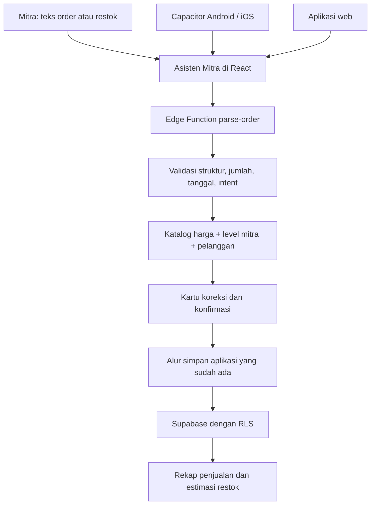

# Rekapan Mitra BP: aplikasi Android/iOS dan Asisten Mitra

Analisis kode dan implementasi awal, 24 Oktober 2026. Pilihan pengguna: **React + Capacitor**.

## Keputusan arsitektur

Pertahankan aplikasi React/TypeScript, Supabase, dan aturan bisnis yang ada. Capacitor membungkus hasil build lokal menjadi aplikasi Android/iOS; tidak memuat situs produksi dalam sebuah iframe. Web, Android, dan iOS berbagi implementasi yang sama. Backend, data mitra, katalog, dan bot Telegram tetap digunakan bersama.



Diagram menggambarkan alur saat ini. Penguatan transaksi database pada bagian temuan di bawah **belum** diimplementasikan.

## Peta proses bisnis yang dipertahankan

| Proses | Implementasi sumber | Perilaku dan hal yang harus tetap berlaku |
|---|---|---|
| Daftar, masuk, sesi, reset sandi | `src/hooks/useAuth.tsx`, `AuthPage`, `ResetPasswordPage` | Supabase Auth; sesi lintas restart. Callback konfirmasi/reset email perlu konfigurasi khusus native sebelum rilis. |
| Onboarding mitra | `useOnboarding.ts`, `ProfileContext.tsx` | Profil, level mitra, modal kustom, stok awal, pengaturan toko. |
| Katalog pusat | `useProducts.ts`, `master_products` | Mitra membaca katalog aktif; mutasi katalog dibatasi admin. |
| Harga penjualan | `catalogPricing.ts`, `pricing.ts` | Tier terbaik antara tier pelanggan dan jumlah botol. Ambang 1/3/5/10/40/200. Harga dari katalog kategori × paket; nominal AI diabaikan. |
| Modal dan margin | `types/index.ts`, `useOrdersDb.ts` | Modal per botol dari level profil atau nilai kustom. Margin tersimpan = omzet − modal − biaya per order. Tidak mengubah model modal menjadi FIFO atau rata-rata pembelian tanpa keputusan bisnis. |
| Pelanggan | `useCustomersDb.ts`, `customerDedup.ts` | Identitas, telepon opsional, alamat/wilayah, tier, pencocokan nama/telepon, statistik pembelian. |
| Order manual dan edit | `TambahOrderFlow`, `OrderForm`, `OrdersPage` | Multi-produk, tanggal order, biaya tambahan, bukti transfer, status, konfirmasi penghapusan. |
| Order dari AI | `ChatInterface`, `orderParser.ts`, Edge Function `parse-order` | Tempel teks chat → ekstraksi → kalkulasi katalog → koreksi → konfirmasi. AI tidak langsung menulis transaksi. |
| Restok | `StockPage`, `useStockDb.ts` | Catatan masuk, modal pembelian, tanggal, bukti, edit/hapus, saldo stok dan riwayat. Saat ini saldo total, belum persediaan per SKU. |
| Laporan | `Dashboard`, `OrdersPage`, `useGeneralExpenses`, `useGeneralIncome`, `useTargets` | Omzet, margin, biaya umum, pendapatan lain, target bulanan, grafik, pertumbuhan pelanggan. |
| Toko publik | `PublicOrderPage`, `useStoreSettings`, RPC `submit_public_order` | Katalog publik, slug, rekening pembayaran, pesanan pelanggan tanpa akun. Jangan menjadikan RPC anonim ini API umum untuk mutasi stok native. |
| Bot Telegram | `supabase/functions/telegram-bot` | Hubungan toko, sesi, parsing, konfirmasi, submit order. Tetap kanal tambahan ke backend yang sama. |
| Admin | Halaman `src/pages/admin`, migrasi RLS/audit | Dashboard, mitra, produk; akses ditentukan server/RLS, bukan sekadar navigasi frontend. |
| Konsultasi produk | `AIHealthAdvisorPage`, `geminiRAG`, `ai-konsultasi` | Tetap fitur terpisah dari asisten transaksi. Jawaban konsultasi bukan sumber harga, stok, atau pencatatan keuangan. |

Hook localStorage lama (`useOrders.ts`, `useStock.ts`) berbeda dari hook database yang dipakai layar aktif. Jangan menggabungkan kedua sumber data atau menganggap localStorage sudah menjadi mekanisme sinkronisasi offline.

## Yang telah dibuat pada tahap ini

- Proyek native `android/` dan `ios/`, konfigurasi Capacitor, serta perintah build/sinkronisasi. App ID awal: `id.biz.mitrabp.rekapan`; pastikan kepemilikan/identitas ini sebelum mendaftarkan aplikasi di store.
- Mode build `mobile` menonaktifkan service worker PWA agar pembaruan aset mengikuti paket aplikasi native. Build web tetap memakai PWA.
- Navigasi **ASISTEN** membuka `/asisten` di dalam proteksi autentikasi dan onboarding yang sudah ada.
- Tombol **Catat penjualan** dan **Catat restok** membuka bot AI yang sudah terhubung ke alur simpan masing-masing. Form manual dan halaman lain tetap tersedia.
- Ringkasan 1/7/30 hari memakai kalender WIB. Omzet mencakup seluruh status, sama dengan dashboard; UI menyebutnya *omzet tercatat*, bukan kas yang sudah diterima.
- Estimasi laba bersih = jumlah margin order − biaya umum + pendapatan lain. Biaya per order tidak dikurangkan dua kali.
- Pembacaan data menggunakan pagination; kegagalan halaman data atau tabel tidak ditampilkan sebagai angka nol.
- Perkiraan restok memakai jumlah botol dari pesanan `selesai` dalam 30 hari penuh sebelumnya. Hari berjalan tidak dipakai untuk laju penjualan.
- Target stok = maksimum 3 botol dan pembulatan ke atas dari rata-rata harian × (lama kirim + hari cadangan). Default 3 + 2 hari dapat diubah. Saran jumlah = target − saldo, minimum nol. Tanpa riwayat penjualan atau saldo diketahui, jumlah tidak dikarang.
- Hasil rekap dapat disalin untuk dibagikan sendiri oleh mitra. Aplikasi tidak mengirim pesan ke pelanggan secara otomatis.
- Demo `/demo/asisten` memakai data sintetis, tanpa memanggil AI atau menyimpan transaksi. Tidak memakai bypass `?demo=true` dari kode lama.
- Validasi hasil AI menolak jumlah nol/negatif/pecahan, produk kosong, dan tanggal tidak valid. Properti harga yang dikirim model dibuang.
- Koreksi pada kartu AI kini memperbarui payload yang dikonfirmasi. Sebelumnya koreksi hanya disimpan sebagai contoh pembelajaran.
- Intent yang berbeda dari mode aktif ditolak; konfirmasi bersamaan dicegah di UI. Ini belum menggantikan idempotensi database.
- Harga fallback untuk produk yang tidak ada di katalog tidak bisa dikonfirmasi lewat kartu AI. Estimasi modal kartu order disamakan dengan rumus yang benar-benar dipakai `useOrdersDb`.

**Batas fitur:** halaman ringkasan dan perencanaan restok menggunakan kalkulasi deterministik, bukan LLM atau prediksi machine learning. AI digunakan untuk membaca pesan pada alur order/restok yang sudah ada. Input suara, OCR nota, pembelian otomatis, dan sinkronisasi offline belum dibuat.

## Temuan yang perlu diselesaikan sebelum rilis produksi mobile

### 1. Order dan stok perlu satu transaksi database

`useOrdersDb.addOrder` membuat header, item, dan biaya dengan beberapa request terpisah. Error insert item/biaya belum diperiksa. Jalur ini tidak memanggil pengurangan stok; sementara `useStockDb.addStock` menulis log dan saldo secara terpisah menggunakan nilai saldo dari client. Edit/hapus juga terdiri dari beberapa operasi.

Akibatnya, internet putus, retry, atau dua perangkat bersamaan dapat menghasilkan header tanpa detail atau saldo yang tidak konsisten. Label “Atomic Expense Tracking” di dokumen lama bukan bukti implementasi sudah atomik. Jangan menambahkan antrean write offline di atas alur ini.

**Rancangan berikutnya:** RPC terautentikasi untuk `create_order`, `update_order`, `delete_order`, dan `receive_stock`; validasi `auth.uid()`, hitung ulang harga dari katalog di server, lock saldo yang terpengaruh, simpan header/detail/biaya/log dalam satu transaksi. Gunakan `request_id` unik per mitra agar retry tidak menggandakan transaksi. Tetapkan kebijakan backorder terlebih dahulu; jangan diam-diam mengganti perilaku order yang saat ini tidak dibatasi stok pada UI.

### 2. Saldo total belum bisa menjadi rekomendasi produk

`user_stock.current_stock` adalah satu angka. Restok AI menggabungkan qty semua produk dan menyimpan nama sebagai catatan. Ini cukup untuk estimasi total yang ditampilkan sekarang, tetapi belum cukup untuk menyarankan “beli BP Green 10, Belgie 3”.

**Rancangan berikutnya:** saldo dan ledger per SKU/kategori produk fisik, terpisah dari baris paket harga. Semua qty dinormalisasi menjadi botol. Tetapkan cara saldo lama dialokasikan saat migrasi. Pisahkan draft rencana pembelian, order ke supplier, barang diterima, dan transaksi penjualan.

### 3. Harga, modal, dan status perlu konsistensi lintas kanal

Frontend memakai `resolveCatalogPricing`, sedangkan kanal lain memiliki resolver masing-masing. Unit katalog dibulatkan ke rupiah; paket 650.000/3 menghasilkan unit 216.667 dan subtotal 650.001 untuk tiga botol. Ini perilaku resolver yang sudah ada, bukan aturan baru dari asisten. Uji parity nilai paket dan tentukan aturan pembulatan sebelum mengubahnya.

Hook aktif mengambil modal dari profil/`MITRA_LEVELS`, walau dokumentasi tertentu menyebut `user_mitra_levels`. Harga modal beauty pada kartu AI sebelumnya berbeda dari modal yang disimpan; tahap ini menyamakan kartu dengan hook penyimpanan. Penentuan modal per SKU perlu keputusan terpisah.

Status `pending`/`terkirim`/`selesai` belum memisahkan status bayar, pemenuhan, dan penerimaan kas. Order internal default `selesai`. Jangan menyebut semua omzet sudah lunas atau memakai stok total sebagai bukti pengiriman.

### 4. AI dan data pelanggan

Model dipanggil lewat Edge Function dengan secret server, bukan key di paket mobile. Validasi client yang ditambahkan harus juga ditegakkan di endpoint dan RPC sebelum produksi. Perlu verifikasi JWT pengguna, batas ukuran input, timeout, rate limit/kuota per mitra, dan pengurangan data pribadi yang dikirim ke model. Instruksi anti-injection saja tidak cukup sebagai kontrol otorisasi.

Contoh koreksi lama disimpan di localStorage dengan key global `rm_bot_learning_patterns`, belum dipisah per akun dan belum menjadi pelatihan ulang model. Sebelum rilis, beri isolasi akun, opsi hapus, batas retensi, serta penjelasan penggunaan data.

### 5. Kesiapan native

Login email/password berbagi kode web; konfirmasi email/reset sandi masih mengarah ke `window.location.origin`. Perlu callback native yang didaftarkan di Supabase dan OS, penanganan cold/warm start, serta uji perangkat nyata. Tombol back Android, keyboard, safe area, upload foto/bukti, akses kamera, external links, clipboard, dan penyimpanan sesi perlu diuji di kedua platform.

Jangan menjanjikan transaksi offline hanya karena aset web tersedia offline. Tahap berikutnya dapat menyimpan **draft lokal**, lalu mengirim setelah online menggunakan RPC idempoten. Sesi native perlu evaluasi penyimpanan aman dan penghapusan pada logout. Review mode demo lama agar tidak menjadi akses write di produksi; RLS harus tetap menjadi batas keamanan.

### 6. Backend dan pemeriksaan kode

Onboarding menemukan akses project Supabase diblokir proxy (CONNECT 403). Draft domain sudah disimpan sebelumnya; ketersediaan runtime/deployment belum terverifikasi. Catatan handoff 14 September juga menyebut migrasi September belum diaplikasikan; status itu harus diperiksa lagi di staging, jangan diasumsikan sudah deployed.

Type-check penuh masih gagal pada kode yang sudah ada: mismatch payload order, mock order, tipe pelanggan/admin, serta import `parseOrderWithAI` yang sudah tidak diekspor. Lint penuh sebelumnya melaporkan 139 error dan 31 warning. Build yang berhasil tidak membuktikan type-check bersih atau transaksi backend berhasil.

## Urutan implementasi lanjutan

1. **Integritas transaksi:** RPC atomik, idempotensi, test dua perangkat/retry/gagal di tengah, parity harga lintas kanal; perbaiki error tipe aktif. Gunakan staging dan akun test.
2. **Persediaan:** putuskan model SKU, satuan/paket, backorder, modal dan saldo awal; migrasi data terverifikasi. Tambahkan penerimaan barang dari rencana pembelian.
3. **Asisten operasional:** draft order/restok dengan biaya terstruktur, pertanyaan klarifikasi untuk pelanggan/produk ambigu, saran restok per SKU. Semua write memerlukan konfirmasi.
4. **Fitur mobile:** callback auth, native navigation/lifecycle, secure storage, kamera/nota jika diperlukan, draft offline dengan status sinkronisasi jelas. Suara/OCR mengikuti kebutuhan pengguna, bukan asumsi tersedia di WebView.
5. **Rilis:** uji perangkat Android dan iPhone, signing, ikon/splash, privacy policy/data safety, verifikasi izin, staging UAT, lalu Play Console/TestFlight/App Store. Tidak ada publikasi otomatis dari pekerjaan ini.

## Menjalankan dan meninjau

Prasyarat yang divalidasi untuk frontend: Node 24.19.0 dan Bun 1.3.14. Dependensi Capacitor dipin ke 8.5.3. `packageManager` menunjuk Bun; `bun.lock` adalah jalur instalasi utama. `package-lock.json` juga direkonsiliasi untuk dependensi baru; jangan memakai `bun.lockb` lama untuk pekerjaan baru.

```bash
cd /workspace/rekapanmitra
/workspace/.setup-tools/node_modules/.bin/bun install --frozen-lockfile
npm test
npm run dev -- --host 0.0.0.0 --strictPort
```

Buka path `/demo/asisten` di server development untuk contoh, atau `/asisten` setelah login. Ini path aplikasi, bukan tautan preview publik.

```bash
# Build lokal dan sinkronkan kedua proyek native (sudah dibuat di repo)
npm run mobile:sync

# Mesin dengan Android Studio + Android SDK dan JDK 21 yang sesuai template
npm run mobile:android

# macOS dengan Xcode dan Swift Package Manager
npm run mobile:ios
```

`mobile:android:init`/`mobile:ios:init` hanya untuk checkout yang belum memiliki folder native, jangan dijalankan berulang. Folder `public` native dan konfigurasi hasil copy diabaikan Git dan dibentuk ulang oleh `mobile:sync`.

Mesin Linux ini tidak memiliki Android SDK atau Xcode. Berhasil membuat/sync proyek bukan bukti APK, AAB, atau IPA telah dikompilasi, ditandatangani, diinstal, atau lolos review store. Kredensial signing/akun store tidak diminta atau ditulis ke repo.

## Hasil validasi tahap ini

| Pemeriksaan | Hasil |
|---|---|
| `bun install --frozen-lockfile` | Lulus; instalasi ulang tidak mengubah dependensi. |
| `npm ci --dry-run --ignore-scripts` | Lulus setelah rekonsiliasi npm lockfile; bukan klaim clean install npm telah dieksekusi. |
| `npm test` | **37 test lulus, 7 file**: harga katalog, deduplikasi pelanggan, batas tanggal WIB, laba, estimasi restok, pagination, schema AI, koreksi payload, mode order/restok, katalog hilang, dan konfirmasi ganda. |
| `npm run build` | Lulus, termasuk service worker PWA web. Peringatan circular chunk dari konfigurasi lama masih ada. |
| `npm run mobile:sync` | Lulus: build mode mobile dan copy/update Android+iOS. Kedua paket aset memiliki `index.html` dan tidak menyertakan `sw.js`. |
| Browser Chromium, viewport 390 × 844 | Demo development dan hasil build berhasil dirender tanpa page error atau overflow horizontal. Ganti periode dan hari pengiriman berfungsi. Demo tidak mengirim request Supabase. |
| Proteksi halaman | Pengunjung tanpa sesi diarahkan ke login dari `/asisten`. |
| Handoff ke bot AI | Ringkasan akun serta pembukaan Bot Order dan Bot Restok lulus dengan respons Supabase **simulasi**. Tidak ada request write; ini bukan uji login/transaksi ke server asli. |
| ESLint modul baru dan perubahan inti AI | Lulus. |
| `tsc -p tsconfig.node.json --noEmit` | Lulus, termasuk konfigurasi Vite dan Capacitor. |
| Type-check aplikasi penuh | Masih gagal pada error yang sudah ada sebelum perubahan; tidak ada error baru pada modul asisten. |
| Lint repository penuh | Masih 139 error dan 31 warning pada kode yang sudah ada. |
| Backend asli, APK/AAB, IPA, perangkat nyata | Belum diverifikasi; akses backend dan toolchain native tetap diperlukan. |

Contoh tampilan hasil pemeriksaan disimpan di `/workspace/artifacts/asisten-mobile.png`. Seluruh pengujian tahap ini memakai kalkulasi lokal, data sintetis, atau respons backend simulasi; tidak ada transaksi produksi yang dibuat atau migrasi remote yang dijalankan.
