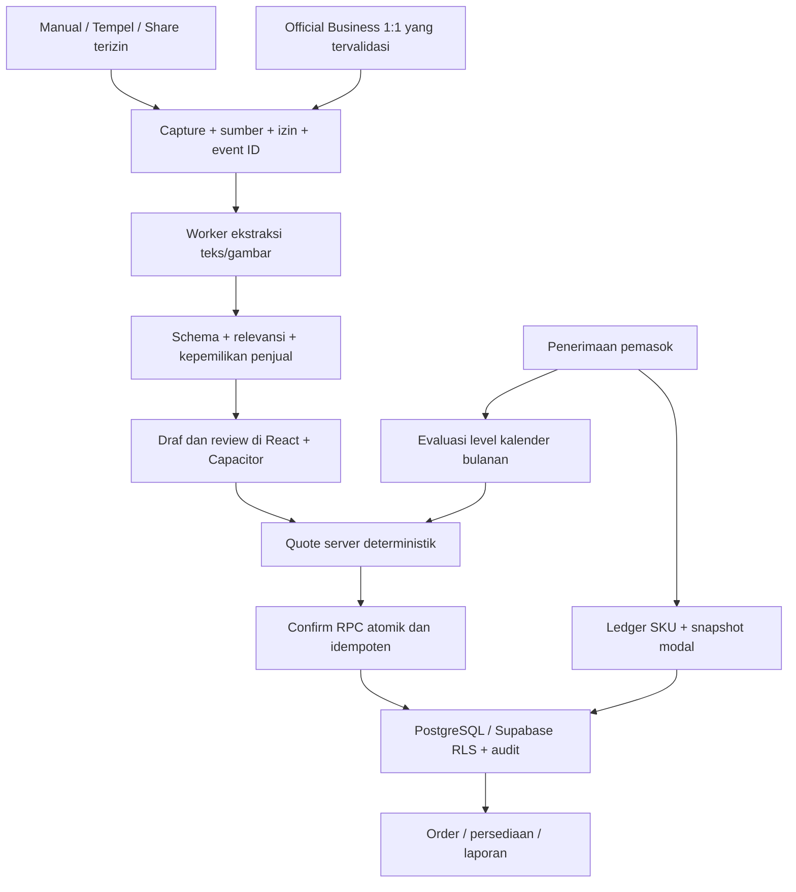

# MULA × Rekapan Mitra BP — rancangan produk gabungan

Versi rancangan 1.0 · 24 Oktober 2026 · status: **rancangan integrasi + prototipe terisolasi, belum perubahan produksi**.

## Hasil yang ingin diterima mitra

Mitra tetap berjualan melalui chat. Aplikasi membantu mengubah chat yang benar-benar merupakan pesanan menjadi draf yang bisa diperiksa, menghitung harga/modal/biaya dengan aturan yang bisa dijelaskan, lalu menunjukkan kondisi usaha beserta tindakan berikutnya.

Empat pertanyaan utama pada Beranda:

1. **Apa yang perlu saya kerjakan?** Draf ambigu, kekurangan alokasi stok, pesanan merugi, dan klaim pembayaran yang belum diperiksa.
2. **Berapa penjualan yang benar-benar sudah disetujui?** Omzet order terkonfirmasi, tanpa draf dan pembatalan; terpisah dari uang yang telah diterima.
3. **Berapa perkiraan hasil usaha?** Nilai jual dikurangi modal snapshot dan biaya penjual, dengan label estimasi dan penjelasan bila data belum lengkap.
4. **Apakah barang dan level mitra saya aman?** Stok per produk, pembelian pemasok bulan berjalan, target ekuivalen, serta perkiraan level bulan berikutnya.

Tujuannya mengurangi pengetikan ulang dan keputusan berbasis angka yang keliru. Dashboard yang cantik tetapi menghitung pertanyaan chat sebagai penjualan tidak memenuhi tujuan ini.

## Sumber, batas bukti, dan keputusan integrasi

- Bahan MULA: ZIP `MULA_Master_PRD_v3.0_Documents.zip`, berisi PRD v3.0 tanggal 24 Oktober 2026 dalam MD/DOCX/PDF. Elaborasi memakai versi Markdown sebagai acuan teks.
- SHA-256 Markdown: `4617a0ef8b816f3117dbac9a9fb2dc4a4f3e73b2ffb45cfa5c29d567687f8e13`.
- Bahan implementasi: checkout `satu1gram/rekapanmitra`, blueprint mobile sebelumnya, hook transaksi/stok, resolver harga, serta migrasi katalog September.
- Source MULA v12, poster harga asli, dataset evaluasi AI, dan backend MULA **tidak ada** dalam lampiran ini. Klaim 32 tes MULA dan bukti simulator adalah laporan di PRD, bukan hasil yang dijalankan pada repository ini.
- Ketentuan dalam PRD adalah bahan kebutuhan produk. Pilihan **React + Capacitor** yang sudah ditetapkan pengguna tetap dipakai; tidak beralih ke React Native/Expo atau menyalin SQLite development menjadi backend publik.
- Backend target memakai fondasi **Supabase/PostgreSQL/Auth/RLS** yang sudah ada, diperkuat RPC atomik, snapshot, audit, dan worker. Tidak perlu memperkenalkan backend kedua hanya karena PRD MULA memakai Node/SQLite pada prototipenya.
- Angka harga MULA dipakai hanya dalam modul simulasi `mulaBusiness.ts`. Katalog, SQL, transaksi historis, dan rumus dashboard produksi tidak diubah.

## Mana yang digabung, dipertahankan, dan ditunda

| Bidang | Keputusan gabungan | Alasan / hasil untuk mitra |
|---|---|---|
| Mobile | React/TypeScript + Capacitor | Memakai ulang layar dan bisnis yang ada; kemampuan Share native tetap perlu plugin/extension dan uji perangkat. |
| Tampilan | Emerald, Bahasa Indonesia, nominal jelas, empat tab | Mengadopsi MULA untuk pengguna 40–65+, tanpa membuang akses stok/katalog/pengaturan. |
| Pencatatan | Tempel/isi manual → draf → review → konfirmasi | Bisa digunakan tanpa menunggu integrasi WhatsApp resmi. |
| Otomasi | AI mengekstrak; server menentukan angka dan izin | Tidak ada model yang bebas menentukan harga, level, atau pembayaran. |
| Order publik/Telegram | Tetap dipertahankan sebagai kanal Rekapan Mitra | Bertahap masuk kontrak draft/quote/confirm yang sama agar harga dan laporan konsisten. |
| Pembelian pemasok | Modul sendiri, terpisah dari penjualan | Restok tidak menaikkan omzet; penjualan tidak menaikkan target pembelian level. |
| Laporan | Confirmed-only untuk kontrak baru; arus kas terpisah | Tidak menganggap draf sebagai omzet atau pesan transfer sebagai penerimaan uang. |
| Inventory | Prioritas pilot BP, bukan menunggu SaaS | Mitra BP perlu tahu produk yang bisa dijual dan barang yang perlu dibeli. |
| Target omzet | Pertahankan fitur target penjualan bulanan yang sudah ada | Target penjualan dan target ekuivalen level adalah dua ukuran berbeda, tidak saling menggantikan. |
| WhatsApp | Receive-only; personal/grup melalui tindakan pengguna | Tidak menjanjikan semua chat/grup terbaca otomatis atau mengirim balasan. |
| SaaS, billing, multi-workspace | Setelah alur internal terbukti | Menyelesaikan pencatatan dan kepercayaan angka lebih dahulu. |

## Konflik aturan yang harus diselesaikan secara eksplisit

| Topik | Kode Rekapan Mitra yang diperiksa | MULA PRD | Perlakuan gabungan |
|---|---|---|---|
| Tarif terbaru | Migrasi September sudah memuat normal 265k dan premium 285k; fallback `pricing.ts` masih 250k dan tarif lama | Tabel September sesuai paket tertentu | Jangan mengatakan semua harga DB lama salah; verifikasi deployment migrasi dan pricebook aktif. Nonaktifkan fallback diam-diam pada kontrak baru. |
| Tier 200/SE | Migrasi September memasukkan 35 juta untuk paket 200 | Harga SE terbaru belum disahkan | Tandai unresolved pada rulebook usulan. Jangan menghapus harga/transaksi lama atau memakai tarif tersebut otomatis. |
| Steffi | Helper legacy `isBeautyProduct` memasukkan Steffi sebagai beauty | Steffi adalah kelompok BP normal | Gunakan ID SKU dan kelompok eksplisit pada kontrak baru, bukan substring nama. |
| Diskon pelanggan | Tier terbaik antara tier pelanggan dan ambang total qty | Harga jual menurut penawaran satuan/paket, sama untuk semua level penjual | Pisahkan **cara jual**, **tier pelanggan**, dan **level modal penjual**. Jangan mengubah harga pesanan lama. |
| Qty nonpaket | Resolver legacy memakai ambang ≥3/5/10/40/200 | Paket 2/4/6/dst belum ditentukan | Sediakan pilihan jual satuan; pemilihan paket yang belum ditetapkan masuk review. |
| Modal | `MITRA_LEVELS`/profil berisi satu harga per botol | Normal/premium/Belgie berbeda; level dan snapshot bulanan | Modal per SKU/kelompok + periode + versi, bukan satu konstanta untuk semua barang. |
| Belgie | Alias lama dapat meratakan berbagai Belgie menjadi satu label | Lima SKU berbeda; modal SAP/SE tidak diketahui | Pertahankan SKU rinci; `null` untuk modal belum diketahui, bukan 0 atau modal BP. |
| Omzet | Dashboard lama menjumlah seluruh status | Hanya confirmed, batal dikeluarkan | Tambah kontrak laporan baru; migrasi status lama dengan rekonsiliasi, bukan pemetaan massal otomatis. |
| Stok | `user_stock` berupa saldo total; simpan order/log/saldo terpisah | Pembelian fisik dan ekuivalen punya fungsi berbeda | Ledger SKU + reservasi/pengiriman; penjualan tidak boleh mengubah ekuivalen level. |

## Pengalaman pengguna akhir

### Beranda: tindakan dahulu, angka berikutnya

Tampilkan periode dan waktu data terakhir dimuat. Kartu utama berisi omzet terkonfirmasi, estimasi laba, dan jumlah order. Di bawahnya ada daftar yang dapat diketuk: **Periksa draf**, **Cek order merugi**, **Siapkan stok**, **Periksa pembayaran**. Setiap insight punya dasar angka dan tombol tindak lanjut; bukan skor “bisnis sehat” tanpa definisi.

Jangan menampilkan nol ketika data gagal dimuat. Jangan memberi proyeksi laba jika modal belum diketahui. Kondisi bisnis bukan hanya omzet besar: margin, beban biaya, stok, dan target pembelian harus dapat dilihat terpisah.

### Tambah: sedikit mengetik, tetap dapat mengoreksi

1. Mitra menempel chat, mengisi manual, atau kelak membagikan teks/gambar lewat native Share.
2. Ekstraksi membedakan pesanan, pertanyaan, perubahan, pembatalan, klaim bayar, dan pembelian pemasok. Nol/satu/banyak kandidat dimungkinkan pada kontrak target.
3. Tampilkan kutipan/bukti sumber dan bagian meragukan. Konfirmasi bahwa penjualan ditujukan kepada usaha pemilik, terutama pada chat grup.
4. Review nama pembeli, SKU, botol fisik, tanggal, cara jual satuan/paket, harga jual, modal, dan semua biaya. Label harga harus menyebut versi/acuan.
5. Kalkulasi langsung memperlihatkan nilai jual, modal, laba kotor, biaya penjual, dan estimasi laba setelah biaya. Buyer-paid langsung ke kurir tidak diperlakukan sebagai beban penjual atau omzet produk.
6. **Simpan draf** tidak menambah omzet/reservasi final. **Konfirmasi** hanya aktif jika data wajib dan aturan harga/modal lengkap.
7. Setelah konfirmasi, order muncul di Pesanan, laporan diperbarui, dan reservasi stok dicatat. Retry harus mengembalikan transaksi yang sama, bukan membuat order kedua.

Contoh yang harus tetap benar: “Ready BP Green?” adalah pertanyaan; “Sudah TF” adalah klaim pembayaran; “restok ke pusat” adalah pembelian pemasok. Ketiganya bukan penjualan baru.

### Pesanan: kejelasan status dan jejak

Pisahkan status order (`draft`, `needs_review`, `confirmed`, `cancelled`), pemenuhan (`unfulfilled`, `reserved`, `shipped`, `completed`), dan pembayaran (`unverified`, `part_paid`, `paid`, `refunded`). Satu status `selesai` tidak cukup untuk mewakili semuanya.

Draf bisa dibuka lagi tanpa mengisi ulang. Perubahan order final membuat revision/event dengan versi dan alasan. Pembatalan mengoreksi omzet serta reservasi tepat sekali; tidak menghapus riwayat. Koreksi terlambat memberi penanda periode yang terpengaruh.

### Laporan: penjualan, kas, stok, dan level terpisah

| Pertanyaan mitra | Angka dan sumber | Tindakan |
|---|---|---|
| Berapa penjualan saya? | Nilai order confirmed setelah diskon sesuai snapshot, periode WIB | Lihat order pembentuk angka. |
| Berapa untungnya? | Penjualan − modal snapshot − biaya order penjual | Periksa transaksi negatif atau modal belum lengkap. |
| Berapa hasil usaha bersih? | Margin setelah biaya order − biaya umum + pendapatan lain | Lihat biaya umum dan pemasukan lain, terpisah agar tidak dihitung dua kali. |
| Uangnya sudah masuk? | Pembayaran terverifikasi − refund/pengeluaran kas | Jangan ambil angka ini dari omzet atau pesan transfer. |
| Apa yang perlu direstok? | On-hand per SKU, reservasi, barang dalam perjalanan, lead time | Buat rencana beli; stok bertambah setelah barang diterima. |
| Level saya bulan depan? | Pembelian pemasok kalender bulan berjalan dalam half-units | Tunjukkan selisih target dan tanggal efektif, bukan dorongan membeli tanpa kebutuhan stok. |

Insight restok sebaiknya mempertimbangkan kebutuhan stok dan kemampuan modal. Pencapaian level tidak otomatis membuat pembelian menguntungkan. Penawaran rencana pembelian harus menampilkan estimasi pengeluaran dan stok setelah pembelian; tidak melakukan order ke supplier secara otomatis.

## Aturan harga, modal, dan periode

### Rulebook usulan dari PRD §7

| Paket | Normal / botol | Green/Blue / botol |
|---|---:|---:|
| Satuan | 265.000 | 285.000 |
| Family 3 | 240.000 | 260.000 |
| Agent 5 | 225.000 | 245.000 |
| Agent Plus 10 | 210.000 | 225.000 |
| SAP 40 | 195.000 | 210.000 |

BP normal: Reguler, Steffi Pro, Brassic Eye, Brassic Pro, Norway. BP premium: Green/Blue. Paket BP dapat mencampur SKU BP dengan mempertahankan tarif kelompok. Tiga normal + dua Green pada paket Agent = **Rp1.165.000**; bila dijual satuan = **Rp1.365.000**. Cara jual harus dipilih, bukan ditebak dari qty saja.

Lima Belgie: Facial Wash, Anti Aging Serum, Day Cream, Night Cream, Hair Tonic. Harga jual satuan **Rp195.000**. Modal Family/Agent **Rp195.000**, Agent Plus **Rp180.000**, SAP/SE **belum diketahui**. Jangan membuat SKU ke-13 atau diskon paket Belgie sendiri. Harga yang disepakati di luar rulebook kelak memerlukan override beralasan dengan izin dan audit; prototipe belum menyediakan override.

Contoh penerimaan:

- Agent menjual satu Green: 285.000 − 245.000 − ongkir 12.000 − infaq 5.000 = **23.000** estimasi laba.
- Agent Plus menjual tiga Belgie: 585.000 − 540.000 − 12.000 − 5.000 − 3.000 = **25.000**.
- Agent menjual Belgie seharga modal dan menanggung ongkir: laba dapat **negatif**; jangan disembunyikan menjadi nol.

### Level mitra bulanan

Pembelian fisik tidak sama dengan ekuivalen: `half_units = 2 × jumlah BP + jumlah Belgie`; ekuivalen = half_units / 2. Tiga BP + empat Belgie adalah **7 barang fisik tetapi 5 ekuivalen**. Penjumlahan dua pembelian satu Belgie harus menjadi satu ekuivalen, tanpa pembulatan tiap pembelian.

Target Family 3, Agent 5, Agent Plus 10, SAP 40. Pada level aktif yang diketahui, pembelian ulang satuan tetap memakai modal level tersebut. Pembelian bulan ini tidak langsung mengubah modal bulan ini. Target bertahan terpenuhi → level bertahan; mencapai target lebih tinggi → naik bulan depan; kurang dari target → reset bulan depan, bukan turun satu tingkat. Selama bulan belum ditutup, hasilnya **perkiraan**, bukan keputusan final.

Level awal/reset, pembelian pertama 1–2 atau 3,5/4 ekuivalen, SE terbaru, pembelian dicatat terlambat, dan alokasi HPP stok lama masuk daftar review. Snapshot evaluasi bulanan menyimpan evidence pembelian, aturan, actor, dan tanggal efektif.

### Snapshot dan laporan

Simpan harga jual, modal, diskon, biaya, rulebook, level, economic date, source, serta waktu konfirmasi. Transaksi historis tidak dihitung ulang ketika katalog atau level berubah. Nilai uang integer rupiah; kuantitas botol integer positif; modal/harga yang tidak diketahui `null`, tidak 0.

Untuk kontrak baru, periode transaksi memakai tanggal usaha yang dipilih dan kalender `Asia/Jakarta`; hanya confirmed yang masuk. Waktu konfirmasi tetap dicatat untuk audit/as-of. Retur, pembatalan sebagian, ongkir yang diterima penjual, dan pergeseran periode historis perlu keputusan pengakuan/reversal tersendiri sebelum diproduksikan.

## Arsitektur yang memakai investasi kode saat ini

Pisahkan tabel/domain katalog SKU dari paket pricebook. Tambahkan `pricebook_versions`, `order_revisions`, `order_events`, `supplier_purchases/lines`, `stock_movements/reservations`, dan `monthly_level_snapshots` secara aditif. Hubungkan dengan `user_id`/workspace dan RLS yang diuji; jangan membuka API SQLite MULA dengan bearer key development.

Kontrak target: `capture` → `quote` tanpa write → `confirm(request_id, draft_version)` → `cancel/revise` dengan audit. Server memperoleh actor/workspace dari sesi, bukan mempercayai payload. Satu transaksi menyimpan header, item, snapshot, biaya, reservasi, audit, dan idempotency record. Concurrent edit memakai version check.

Webhook hanya menerima pesan yang tersedia melalui akses resmi. Validasi signature, dedupe event ID, acknowledge cepat, lalu worker. Jangan menambahkan WhatsApp send/reply/reaction. Dedupe transport berbeda dari dugaan chat/screenshot yang sama; duplikat semantik lemah harus direview, bukan digabung otomatis.

## Tahapan implementasi dan bukti selesai

| Tahap | Hasil yang dapat dipakai | Gate, bukan sekadar daftar fitur |
|---|---|---|
| A — Rancangan dan simulasi (pekerjaan ini) | Empat tab, draf/review, kalkulasi, confirm/cancel sesi, pembelian, level dan stok contoh | Golden tests MULA, browser mobile, tanpa backend produksi; tidak diklaim live AI. |
| B — Fondasi transaksi staging | Quote/confirm/cancel RPC, idempotensi, snapshot, audit, SKU mapping, laporan baru | Replay/double-click/network failure tidak ganda; salah tenant ditolak; subtotal/biaya/reservasi rollback bersama. |
| C — Pilot pencatatan terbantu | Paste/manual → AI opt-in → review → transaksi staging, biaya umum/pendapatan lain, pencarian/filter | Dataset terizin dan holdout; pertanyaan/claim bukan order; salah SKU/jumlah tidak dapat auto-confirm. |
| D — Persediaan dan level | Penerimaan per SKU, reservasi/pengiriman, modal, tutup bulan dan backdate reconciliation | 3 BP + 4 Belgie = 5 ekuivalen; upgrade efektif bulan berikutnya; histori tetap; saldo ledger cocok stok. |
| E — Mobile dan konektor | Native Share text/image, draft offline, auth callback, secure session; official WhatsApp nomor uji bila eligible | Android/iPhone nyata, retry idempoten, izin dan retensi, indikator coverage; outbound WhatsApp nol. |
| F — Private beta | Pengguna BP nyata dengan staging→production migration terkontrol | Usability 40+, backup/restore, monitoring, delete/export, sign-off pricebook, reconciled reports. |
| G — SaaS | Workspace/RBAC, onboarding, metering/billing dan support | Isolasi tenant dan biaya terbukti; tidak menjual janji semua WhatsApp/grup terbaca otomatis. |

Prioritas B sebelum antrean write offline/auto-confirm. Tim boleh mengerjakan UI/capture secara paralel secara organisasi, tetapi gate integritas transaksi tidak dilewati. Tidak ada estimasi tanggal selesai tanpa mengetahui kapasitas tim, akses staging, dan keputusan harga.

## Status implementasi setelah penggabungan

**Sudah di kode preview:** `MulaDemo.tsx` menggantikan entry demo saja; empat tab, data sintetis sesi, parser pola lokal dengan label jujur, koreksi manual, multi-biaya/payer, quote PRD, draf/konfirmasi/pembatalan, jejak simulasi, snapshot order, confirmed-only report, salin rekap, kerugian, pembelian diterima, evaluasi bulan berikutnya, dan saldo alokasi SKU contoh.

**Tetap memakai alur lama:** aplikasi produksi, halaman `/asisten` terautentikasi, hooks Supabase, harga katalog aktif, bot Telegram, order publik, serta native shell. Domain MULA belum terhubung ke write produksi.

**Belum dibuat:** model AI/vision live, consent workflow lengkap, screenshot upload, native inbound Share, konektor Meta live, kas/pembayaran/retur, biaya umum dan pendapatan lain di prototipe baru, RPC integrasi MULA, penyimpanan durable/queue offline, migrasi data, alokasi lot/FIFO, prediksi permintaan SKU, monthly close otomatis, export/report CSV, override harga, SaaS/billing, serta uji perangkat native.

Saldo stok demo = enam botol contoh per SKU + barang diterima − alokasi order confirmed; pembatalan mengembalikan alokasi. Ini bukan implementasi persediaan fisik produksi. Parser contoh mengenali pola terbatas; bukan bukti model AI mencapai target akurasi. Draft hanya di memori dan hilang saat reload, tidak menjanjikan offline safety.

## Uji penerimaan produk

- Draf tidak mengubah omzet; confirm menambah sekali; cancel mengoreksi sekali dengan jejak.
- Harga belum diketahui memblokir confirm dan menampilkan alasan yang dapat diperbaiki.
- Nominal dan biaya berubah langsung setelah pengguna mengoreksi item/biaya.
- Order lama tetap sama saat level simulasi berganti; pembelian tidak meningkatkan omzet.
- Pertanyaan, klaim transfer, revisi, dan pembelian masuk penanganan masing-masing.
- Angka negatif dan modal belum diketahui terlihat jelas, bukan dinolkan.
- Label sesi/simulasi tetap terlihat; build tidak memuat Auth/Supabase dan tidak menghubungi host eksternal.
- Font, target sentuh, keterbacaan angka, dan pembacaan screen reader diverifikasi sebelum pilot; prototipe mengutamakan teks 16px dan kontrol 48px, tetapi belum merupakan sertifikasi aksesibilitas atau uji usia 40+.

Target pilot dari MULA (belum hasil): auto precision ≥98%, recall termasuk review ≥90%, exact SKU+qty ≥95% untuk pesan jelas, replay event ID tanpa duplikat, golden pricing terdefinisi 100%, dan WhatsApp outbound 0. Ukur cakupan capture terpisah dari akurasi AI. Tambahkan durasi review per order, persentase tanpa ketik ulang, order terlewat, error laba, dan keberhasilan tugas pengguna usia 40+.

## Keputusan yang masih diperlukan sebelum aktivasi transaksi baru

1. Poster/pricebook resmi, tanggal berlaku, dan tarif 200/SE terbaru; modal Belgie SAP/SE.
2. Paket qty nonstandar, campuran BP+Belgie, override harga, dan pembelian awal/reset.
3. Backorder vs wajib stok, kapan stok direservasi/dikeluarkan, retur dan pembatalan sebagian.
4. Snapshot modal estimasi vs lot aktual/FIFO; perlakuan stok awal dan tanggal pembelian terlambat.
5. Pemetaan status/data lama, saldo awal SKU, batas periode untuk laporan baru, serta aturan koreksi historis.
6. Apakah ongkir dibayar langsung ke kurir atau diterima penjual; pengakuan kas/biaya yang sesuai.
7. Nomor Business resmi untuk pilot, cakupan konektor, media yang diizinkan, dan kebijakan retensi.

Keputusan ini tidak menghalangi preview. Jawabannya kelak disimpan sebagai rulebook/migration/test case, bukan asumsi tersembunyi di prompt AI.

## Cara mencoba hasil gabungan

Branch `preview/mobile-ai`, proyek demo Cloudflare `rekapanmitra-mobile-demo`, command `npm run build:cloudflare-preview`, output `dist`, root repository. URL deployment sebelumnya: `https://rekapanmitra-mobile-demo.pages.dev/`; URL ini diketahui dari pengguna, status deployment commit terbaru perlu diperiksa di Cloudflare.

1. Beranda menampilkan contoh Green/Belgie, termasuk order dengan laba negatif karena biaya.
2. **Tambah** → contoh Green → **Isi draf dari teks contoh**. Periksa buyer/item/biaya; coba simpan draf dan lihat omzet belum bertambah.
3. Buka draf, centang pemeriksaan, konfirmasi. Lihat perubahan angka dan jejak order; coba pembatalan.
4. Coba **Ready BP Green?** atau **Sudah transfer ya**. Tidak ada order baru atau status lunas otomatis.
5. Coba Belgie pada SAP: modal belum tersedia dan confirm diblokir. Untuk contoh laba 25k, pilih tiga Belgie, level Agent Plus, biaya 12k/5k/3k.
6. Di **Laporan**, catat penerimaan pemasok. Omzet tidak bertambah; alokasi stok dan target ekuivalen berubah. Ganti bulan untuk melihat pemisahan periode.

Tidak ada chat pelanggan, secret, koneksi database, migrasi remote, atau transaksi asli yang diperlukan untuk mencoba prototipe ini.

## Bukti validasi pekerjaan ini

- `npm test`: **56 tes lulus, 8 file**, termasuk 19 kasus baru aturan MULA. Terpisah dari klaim 32 tes backend v12 pada lampiran.
- `node --test scripts/verify-preview-output.test.mjs`: **4 tes build isolation lulus**.
- Build preview lulus, termasuk guard tanpa module Auth/Supabase, source TSX mentah, atau endpoint produksi.
- Chromium 390 × 844: Green 23k, Belgie Agent Plus 25k, draf tidak masuk omzet, confirm/cancel, modal belum tersedia diblokir, inquiry/claim tidak jadi transaksi, pembelian tidak menaikkan omzet, ekuivalen bulanan, copy rekap, dan reset saat reload lulus. Tidak ada page error, request eksternal, atau overflow horizontal.
- ESLint modul baru lulus. Type-check seluruh aplikasi masih memiliki error lama; tidak ada error baru pada modul MULA. Bukan klaim type-check repository bersih.
- Contoh tampilan: `/workspace/artifacts/mula-bp-home.png` dan `/workspace/artifacts/mula-bp-review.png`.
- Belum menjadi bukti deployment commit terbaru berhasil, model AI live tervalidasi, transaksi server atomik, atau uji iPhone/Android fisik.
